<p align="center">
  
</p>

<p align="center">
  <a href="https://github.com/LordVicky/OpenDS5/actions/workflows/release.yml"></a>
  <a href="ds5-bridge/LICENSE"></a>
  <a href="https://github.com/LordVicky/OpenDS5/releases"></a>
  <a href="https://discord.gg/hg5AF3zM5D"></a>
</p>
<p align="center">
  
  
</p>

**Everything your DualSense can do, on Linux, without the cable.** OpenDS5
lets you shape your controller's adaptive triggers, haptics, audio, lighting,
and buttons from one app — while your games see a wired DualSense with all
its native features unlocked, even though you're playing over Bluetooth.

<p align="center">
  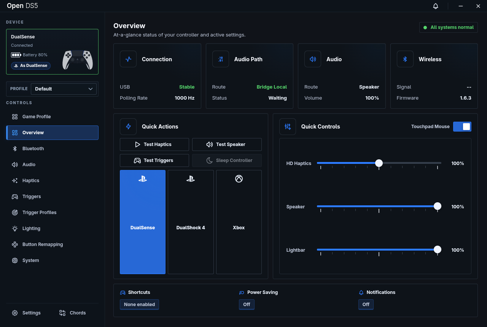
</p>

---

- [Features](#-features)
- [Screenshots](#-screenshots)
- [Why the "wired" part matters](#-why-the-wired-part-matters)
- [What's new in this fork](#-whats-new-in-this-fork)
- [Supported distros](#-supported-distros)
- [Getting started](#-getting-started)
- [How it works](#%EF%B8%8F-how-it-works)
- [Limitations of custom trigger profiles](#%EF%B8%8F-honest-limitations-of-custom-trigger-profiles)
- [Contributing game profiles](#-contributing-game-profiles)
- [Credits & license](#-credits--license)

## ✨ Features

- 🎮 **Wireless-to-wired bridge (via vds)** — play Bluetooth, look wired.
  Unlocks native DualSense features in games that normally demand a cable.
  OpenDS5 installs and manages vds for you, so this works out of the box.
- 🧪 **Trigger Lab** — design your own adaptive trigger effects with the full
  DualSense effect surface: constant resistance, weapon-style breaks,
  vibration, resistance ramps, and 10-zone custom curves. Live-preview
  everything on your controller.
- 🎭 **Controller personas** — present your DualSense to the PC as a
  **DualShock 4** or an **Xbox 360** controller for games that don't support
  the DualSense, switchable from the app without dropping the Bluetooth link.
- 🎯 **Per-game trigger profiles** — OpenDS5 detects the game you're running and
  applies your saved trigger effects automatically. Great for games with no
  native DualSense support. Games from **Steam, Heroic and Lutris** are found
  automatically, and any game can be linked to one of your own controller
  profiles.
- 📚 **Profile library** — browse and install community-made game profiles from
  inside the app. The library lives in its own repo
  ([OpenDS5-Profiles](https://github.com/LordVicky/OpenDS5-Profiles)), so new
  game profiles arrive without waiting for an app update. Import/export lets
  you share profiles as plain JSON files.
- 🔊 **Haptics & controller audio** — route sound to the controller's speaker
  and headphone jack, with haptic feedback support.
- 💡 **Lighting** — control the lightbar and player LEDs.
- 🎛️ **Button remapping, personas & chords** — remap buttons, save setups as
  switchable personas, and trigger actions with button combinations.
- 📶 **Bluetooth mode switching** — flip between *OpenDS5 mode* (vds owns the
  controller) and *normal mode* (your Bluetooth keyboards, mice and other
  pads work again) from the app, or let it switch automatically when no
  controller has been connected for a while.
- 📦 **Painless install — and uninstall** — one AppImage. A first-launch setup
  wizard installs the kernel module and background service for you (one
  password prompt), with Secure Boot handled. App updates rebuild the kernel
  module automatically, and a one-click uninstaller removes everything again.
  See [Supported distros](#-supported-distros).

## 📸 Screenshots

| | |
| --- | --- |
| **Game Profiles** — cover art, native-feature flags, per-game everything 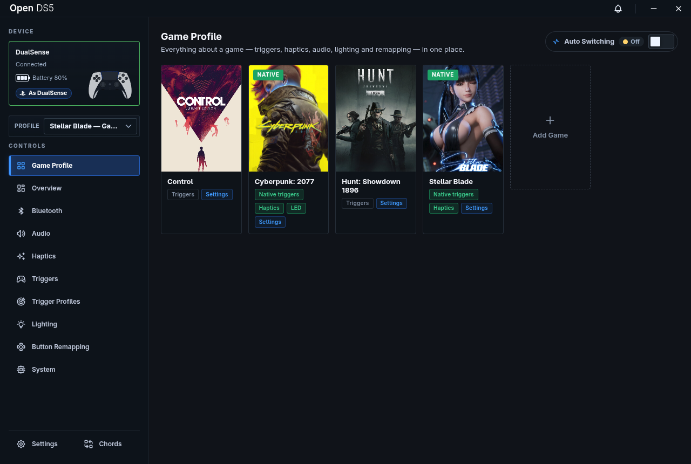 | **Trigger Lab** — design adaptive trigger effects, feel them live 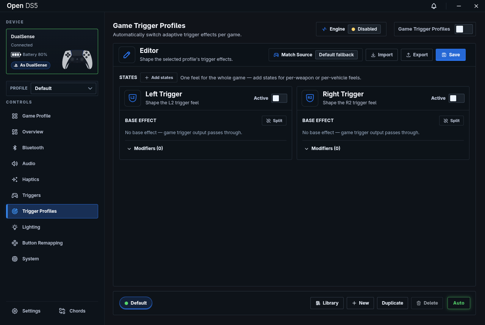 |
| **Haptics** — HD haptics, rumble and audio-reactive feedback 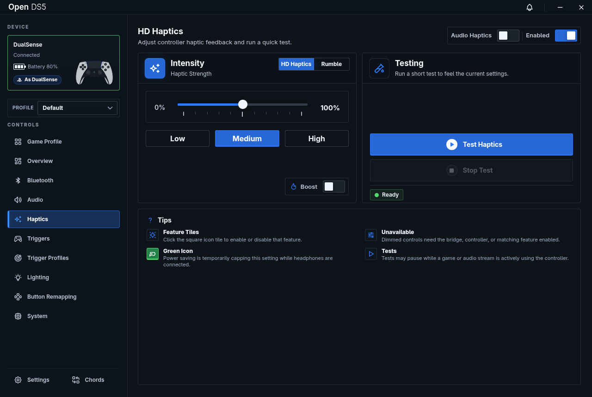 | **Chords** — button combos that fire functions in any game 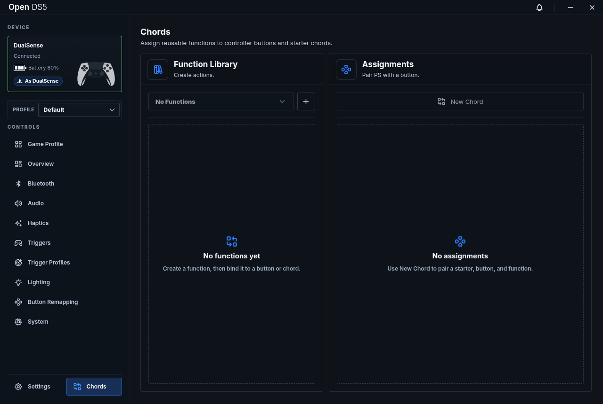 |

<details>
<summary><b>More screenshots</b> — audio, triggers, lighting, remapping, system</summary>

| | |
| --- | --- |
| **Audio** 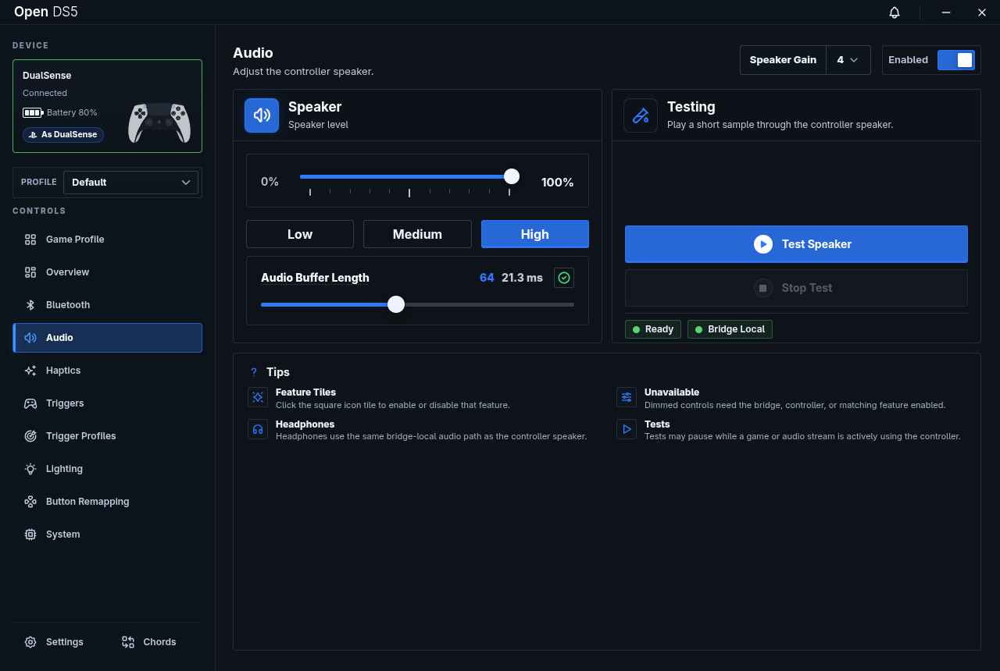 | **Adaptive Triggers** 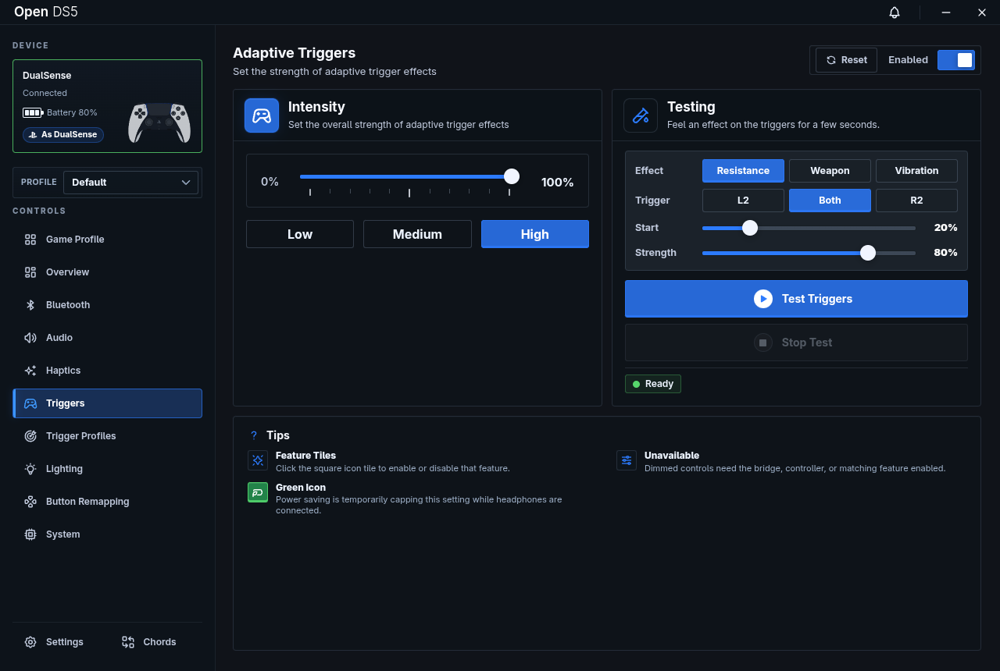 |
| **Lighting** 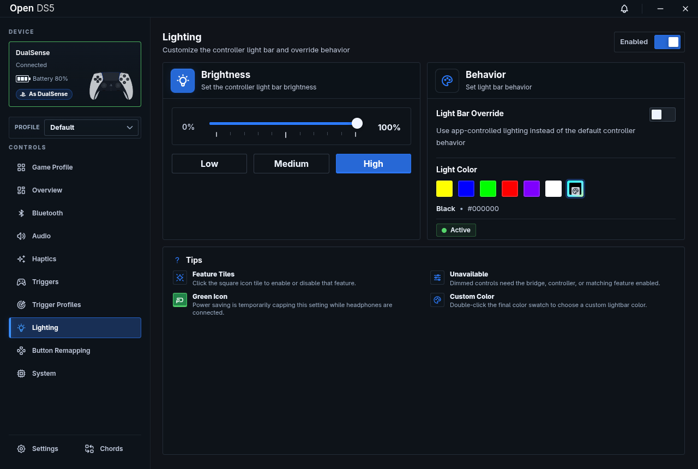 | **Button Remapping** 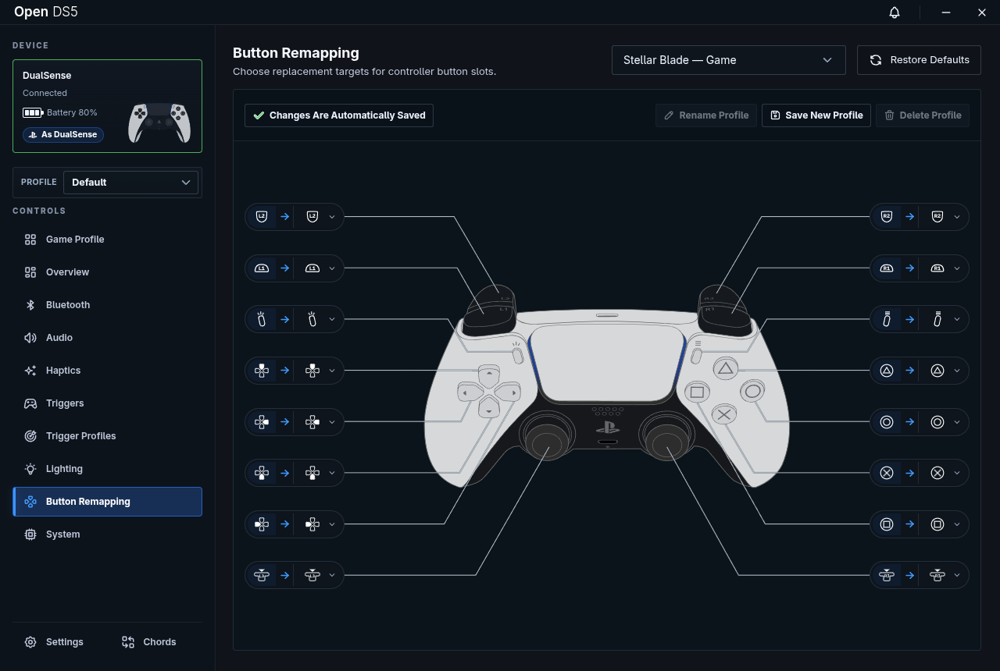 |
| **System** 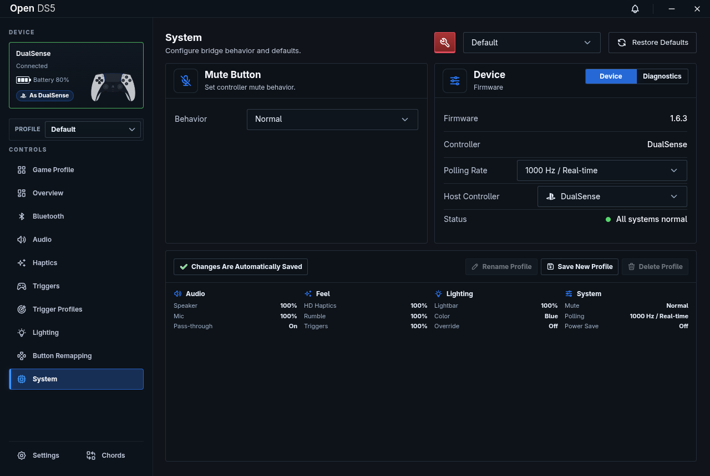 | **Bridge Settings** 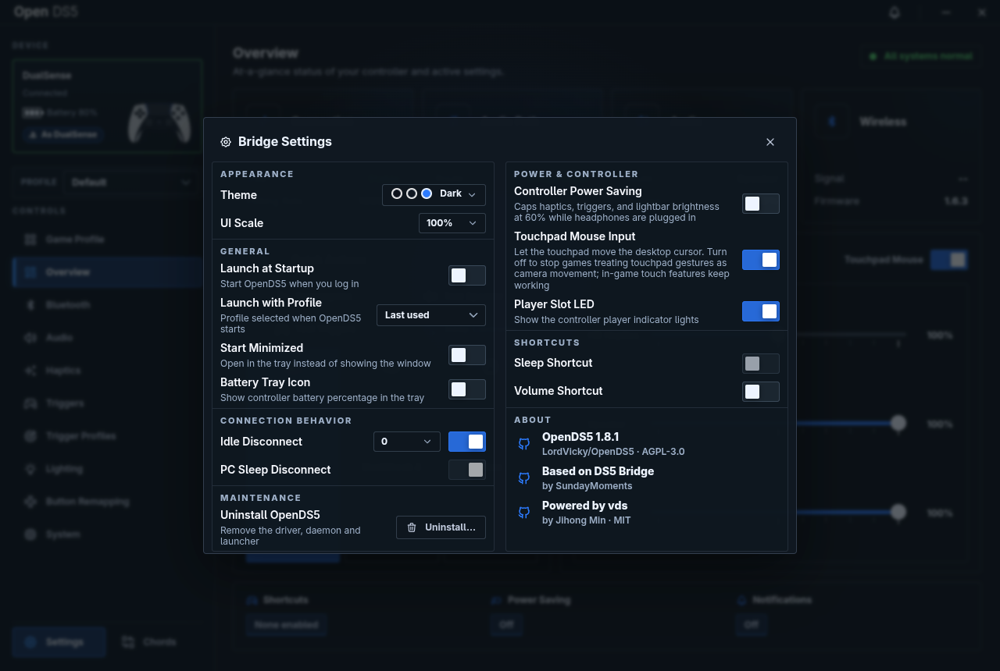 |

</details>

## 🔌 Why the "wired" part matters

Many games with native DualSense support (adaptive triggers, haptics,
controller audio) only enable those features when the controller is plugged
in over USB. Over plain Bluetooth you get a basic gamepad and nothing else.

With vds running under OpenDS5, your controller stays wireless but games see
a USB-connected DualSense. Native trigger effects, haptics, and speaker audio
in supported games just work — no cable.

## 🆕 What's new in this fork

This fork builds on [LordVicky/OpenDS5](https://github.com/LordVicky/OpenDS5)
1.8.1 with the following additions:

### Controller personas (DualShock 4 / Xbox 360)
- The `vds_hcd` kernel module gains two new virtual USB profiles: a
  **DualShock 4** (`054c:09cc`, HID) and an **Xbox 360 wired controller**
  (`045e:028e`, XUSB, bound by the kernel's `xpad` driver).
- `vdsd` translates DualSense input into DS4 / XInput reports and maps
  rumble and lightbar output back onto the DualSense. DS4 feature reports
  (calibration, MAC) are answered from the real controller's data.
- Pick the persona in the app (`SET_HOST_PERSONA`); the virtual controller
  re-enumerates with the new identity while the Bluetooth link stays up.

### Bluetooth mode and controller management
- New **Bluetooth** panel: switch between OpenDS5 mode and normal mode
  (BlueZ input plugin back on, so other Bluetooth input devices work).
- Optional **auto switching**: drop to normal mode after a configurable idle
  time (10 s – 1 h) with no controller connected, and return to OpenDS5 mode
  as soon as a registered DualSense connects.
- See every paired controller's state (paired / connected / attached /
  bridged) and attach or detach controllers from vds.

### Audio fixes
- Speaker packets are now paced to the 512-frame extraction window
  (~10.67 ms) with a small priming buffer, fixing periodic crackles and
  underruns over Bluetooth.
- Sending audio no longer un-mutes the microphone, and the speaker volume
  set by the game or app is kept instead of being forced to max.
- New `SET_SPEAKER_GAIN` command (preamp levels 1–7).
- The WirePlumber config now forces a plain 4.0 sink (speaker + haptics) for
  the virtual DualSense / DualSense Edge, and the installer restarts
  WirePlumber so it applies without logging out.

### Companion app
- **Game library**: installed games are detected from Steam, **Heroic Games
  Launcher** and **Lutris**, with a search box; scanning no longer stalls on
  large game binaries.
- **Profile when playing**: link a game to one of your own controller
  profiles; auto switching selects it whenever that game is running.
- **Launch with profile** and **Start minimized** (open in the tray) settings,
  plus a proper login item (XDG autostart entry) for the AppImage.
- **Diagnostics**: view the `vdsd` log and toggle input/output tracing from
  the app.
- **Test Triggers**: vds has no microphone path, so the Overview's microphone
  quick action is replaced with a button that plays a test effect on the
  triggers.
- **Uninstall** from the settings menu, optionally purging app settings.

### Installer
- `opends5-install --uninstall [--purge]` (or
  `./OpenDS5.AppImage --uninstall-system`) removes the module, `vdsd`, udev
  rules, WirePlumber config, BlueZ override, `vds` group and launcher. Every
  step runs even if an earlier one fails, and is logged.
- `--rebuild-module` forces a fresh DKMS build; app updates use it so a newly
  shipped module replaces the loaded one.
- The BlueZ override script is always installed, so `vdsd` can switch
  Bluetooth modes at runtime.

### Tests
- New C++ tests for personas, Bluetooth input reports and speaker gain
  (`ctest` in `vds/`), an installer uninstall test, and updated companion
  tests.

## 🐧 Supported distros

OpenDS5 ships a small kernel module (`vds_hcd`, from vds) that it installs
through **DKMS** — your distro's standard mechanism for out-of-tree modules.
DKMS builds the module against your running kernel and automatically rebuilds
it on every future kernel update, so it keeps working after upgrades. The
setup wizard handles all of this; the table below shows what it does on each
platform:

| Distro | How the module is installed |
| --- | --- |
| **Fedora** | `dnf` installs `dkms` + `kernel-devel` (or `kernel-cachyos-devel` on COPR kernels), then DKMS builds the module |
| **Arch / CachyOS** | `pacman` installs `dkms` + headers matched to your kernel flavor (`linux-cachyos-headers`, `linux-zen-headers`, …); Clang/LTO kernels build with `LLVM=1` |
| **Debian / Ubuntu** | `apt` installs `dkms` + `linux-headers-$(uname -r)` |
| **openSUSE** | `zypper` installs `dkms` + `kernel-default-devel` |
| **Bazzite / Silverblue** | `rpm-ostree install dkms kernel-devel` layers the packages; one reboot, then re-run the wizard |
| **NixOS** | Declarative flake module — add `inputs.opends5.nixosModules.default`, enable `services.opends5`, then apply with `nixos-rebuild switch` |

On every DKMS platform the installer then registers the module source under
`/usr/src/`, builds it, and enables autoload — after that, kernel updates are
handled for you. **Secure Boot** is supported too: the module is signed with
DKMS's own MOK key, and if that key isn't enrolled yet the wizard walks you
through the one-reboot enrollment.

On anything else, the installer exits with a clear "unsupported" message —
see [docs/PORTING.md](docs/PORTING.md) for manual steps.

## 🚀 Getting started

1. Download the latest `OpenDS5.AppImage` from
   [Releases](../../releases) and make it executable.
2. Run it. The setup wizard shows exactly what it will install (DKMS kernel
   module, `vdsd` service, udev rules) and does it after one password prompt.
3. Pair your DualSense over Bluetooth and you're done.

> [!NOTE]
> vds needs to own the controller's Bluetooth HID channels, so setup disables
> BlueZ's input plugin — without this the system grabs the DualSense as a
> plain gamepad and OpenDS5 never sees it. While that's in effect, other
> Bluetooth keyboards and mice don't work. Use the **Bluetooth** panel in the
> app to switch to *normal mode* when you need them (or enable automatic
> switching), and back to *OpenDS5 mode* to play.

Prefer the terminal? `./OpenDS5.AppImage --install-system` does the same
setup, and `./OpenDS5.AppImage --uninstall-system [--purge]` removes it all
again (also available in the app's settings menu). See [docs/INSTALLER.md](docs/INSTALLER.md) for per-platform details,
exit codes, and logs.

## ⚙️ How it works

```
DualSense (Bluetooth)
   │
   ▼
vds_hcd.ko + vdsd            ← presents a virtual USB DualSense to the system
   │
   ▼
OpenDS5 app (Electron)       ← triggers, haptics, audio, lighting, remapping
   │
   ▼
Your games                   ← see a wired DualSense
```

OpenDS5 stands on the shoulders of some great projects:

- [**DS5Dongle**](https://github.com/awalol/DS5Dongle) by
  [awalol](https://github.com/awalol) pioneered the whole idea: firmware that
  turns a Pico 2 W into a DualSense dongle, making a wireless controller
  appear wired to the host. It's the foundation everything else here traces
  back to.
- [**DS5_Bridge**](https://github.com/SundayMoments/DS5_Bridge) by
  [SundayMoments](https://github.com/SundayMoments) built a Windows companion
  GUI on top of DS5Dongle, and it's where OpenDS5 began. We ported it to
  Linux, swapped the Pico hardware for vds, and then kept building on that
  foundation — a trigger effect designer, per-game profiles, a community
  profile library, and a one-click installer.
- [**vds**](https://github.com/hurryman2212/vds) by
  [hurryman2212](https://github.com/hurryman2212) is the breakthrough that
  brought all of this to Linux. Where DS5Dongle needed a Pico plugged into
  the machine, vds does the same job entirely in software: a kernel module
  and daemon that pick up your Bluetooth DualSense and present it to the
  system as a genuine USB-wired one. Before vds, none of this existed on
  Linux — every feature in OpenDS5 flows through it, and this project simply
  wouldn't exist without it.

## ⚠️ Honest limitations of custom trigger profiles

Custom profiles are powerful, but it's worth being clear about what they can
and can't do:

- **They react to your finger, not the game.** A profile can change the
  trigger feel based on how far you've pulled it (e.g. vibrate on full pull),
  but it has no idea what's happening in-game. It can't tell whether you're
  out of ammo, driving on gravel, or drawing a bow — only native game support
  can do that.
- **Don't stack them on natively supported games.** If a game already drives
  the triggers itself, a custom profile will fight it. For those games, let
  the game do the work — OpenDS5's wired bridge is what makes that possible.
- **State switching is inferred, not game-truth.** A profile can hold several
  named states ("Pistol", "Shotgun", "Driving") and switch between them when
  you press the game's own swap buttons — but OpenDS5 only sees your inputs,
  never the game. If the game blocks a swap (out of ammo, cutscene), the
  tracked state can drift; the state chips in the app and select-style rules
  re-sync it in one press.
- **Reactive effects need input access.** Modifiers that respond to trigger
  position read the controller's input device, which usually requires your
  user to be in the `input` group. Without it, the profile's base effect
  still works; only the reactive parts are skipped.
- **Some effect modes need a current `vdsd`.** The newer modes
  (`multi-feedback`, `slope`, `multi-vibration`, frequency-controlled
  `vibration`) use the V2 trigger command. If they do nothing, update the
  daemon with `./update-vdsd.sh`.

## 🤝 Contributing game profiles

Made a trigger profile you like? Export it from the app and open a PR against
[OpenDS5-Profiles](https://github.com/LordVicky/OpenDS5-Profiles) — one game
per PR, branch named after the game. CI validates profiles with the same
rules the app enforces, and merged profiles appear in everyone's in-app
library automatically.

## 🙏 Credits & license

OpenDS5 wouldn't exist without these projects — thank you:

- [hurryman2212/vds](https://github.com/hurryman2212/vds) — the virtual
  DualSense kernel module and daemon that make the wireless-to-wired bridge
  possible on Linux in the first place (MIT).
- [awalol/DS5Dongle](https://github.com/awalol/DS5Dongle) — the original
  Pico 2 W DualSense dongle project that DS5_Bridge, and by extension
  OpenDS5, is founded on.
- [SundayMoments/DS5_Bridge](https://github.com/SundayMoments/DS5_Bridge) —
  the Windows companion GUI for DS5Dongle that OpenDS5 was ported from and
  grew out of (AGPL-3.0-only).

The combined work is **AGPL-3.0-only**. Files under `vds/` retain their
upstream MIT license. See `ds5-bridge/LICENSE`, `ds5-bridge/NOTICE`, and
`vds/LICENSE`.
