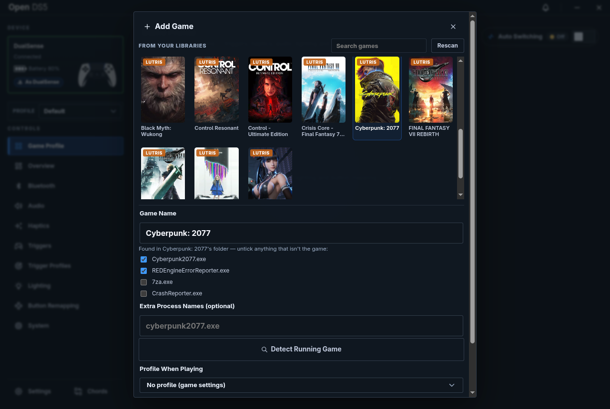
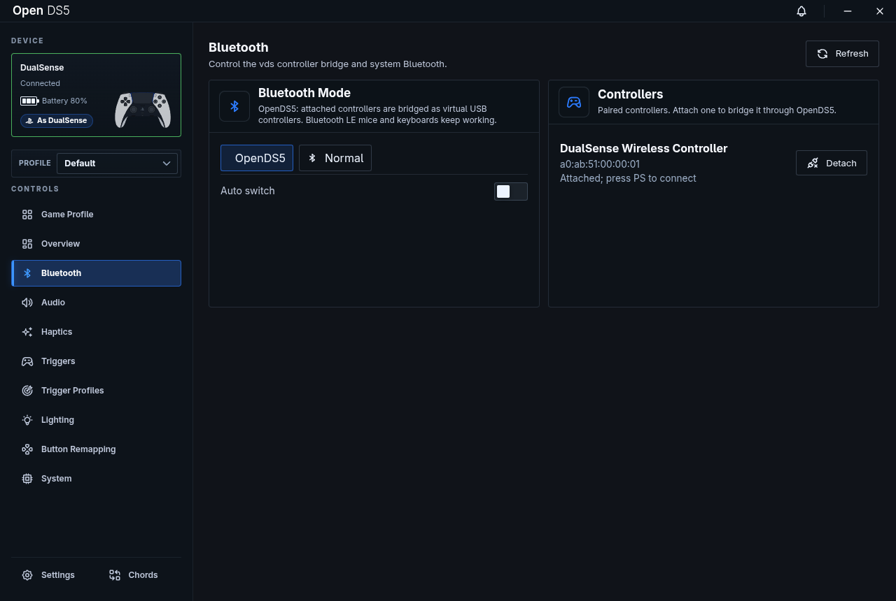

<p align="center">
  <a href="https://github.com/Virmin8/OpenDS5"></a>
</p>

<p align="center">
  <a href="https://github.com/Virmin8/OpenDS5/actions/workflows/release.yml"></a>
  <a href="https://github.com/Virmin8/OpenDS5/releases"></a>
  <a href="ds5-bridge/LICENSE"></a>
</p>
<p align="center">
  
  
  
</p>

**Everything your DualSense can do, on Linux and Windows, without the cable.** Shape your
controller's adaptive triggers, haptics, audio, lighting and buttons from one
app, while games see a wired DualSense with all its native features, even over
Bluetooth.

<sub>🤖 Built with help from [Claude](https://claude.com/claude-code), Anthropic's AI coding assistant.</sub>

<p align="center">
  
</p>

---

- [Features](#-features)
- [Screenshots](#-screenshots)
- [Why "wired" matters](#-why-wired-matters)
- [Getting started](#-getting-started) · [Windows](#windows) · [Pairing](#-pairing-your-controller)
- [Supported distros](#-supported-distros)
- [Controller shortcuts](#%EF%B8%8F-controller-shortcuts)
- [Microphone](#%EF%B8%8F-microphone)
- [Troubleshooting](#-troubleshooting)
- [How it works](#%EF%B8%8F-how-it-works)
- [Limitations of custom trigger profiles](#%EF%B8%8F-limitations-of-custom-trigger-profiles)
- [About this fork](#-about-this-fork)
- [Credits & license](#-credits--license)

## ✨ Features

- 🎮 **Wireless, but wired to your games** — native adaptive triggers, HD haptics and speaker audio over Bluetooth.
- 📳 **Low-latency HD haptics** — the controller buffer follows your Bluetooth link packet by packet.
- 🧪 **Trigger Lab** — design adaptive trigger effects (resistance, breaks, vibration, ramps, 10-zone curves) with live preview.
- 🎭 **Controller personas** — appear as a **DualShock 4** or **Xbox 360** controller for games without DualSense support.
- 🎯 **Game-linked profiles** — switch profiles automatically while a game runs; finds **Steam, Heroic and Lutris** games (**Steam, Epic and Heroic** on Windows).
- 🔊 **Audio** — controller speaker and headphone jack, with a loudness boost for the built-in speaker.
- 🎙️ **Microphone** — controller or headset mic in Linux, with one on/off switch, the Mute button and mute light, level and processing.
- 💡 **Lighting** — lightbar and player LEDs.
- 🎛️ **Remapping & chords** — remap buttons and trigger actions with button combos.
- 📶 **Bluetooth modes** (Linux) — switch between OpenDS5 mode and normal mode (keyboards and mice work again), or automatically.
- 🕹️ **Controller shortcuts** — volume, profile and power with a touchpad click, mid-game.
- 📦 **Easy install & uninstall** — AppImage with a setup wizard, a pacman package for Arch, a NixOS flake, or a Windows installer.

## 📸 Screenshots

| | |
| --- | --- |
| **Game Profiles** — your games with cover art and native-feature flags  | **Add Game** — pick from Steam, Heroic and Lutris and choose a profile  |
| **Bluetooth** — switch modes and attach or detach controllers  | **Triggers** — trigger strength with a built-in effect tester  |

<details>
<summary><b>More screenshots</b> — audio, haptics, Trigger Lab, lighting, remapping, chords, system, settings</summary>

| | |
| --- | --- |
| **Audio**  | **Haptics**  |
| **Trigger Lab**  | **Lighting**  |
| **Button Remapping**  | **Chords**  |
| **System**  | **Settings**  |

</details>

## 🔌 Why "wired" matters

Many games only enable adaptive triggers, HD haptics and controller audio when
the DualSense is plugged in over USB; over plain Bluetooth you get a basic
gamepad. OpenDS5 keeps your controller wireless but shows games a USB-connected
DualSense, so those features just work.

## 🚀 Getting started

Pick one install method, then [pair your controller](#-pairing-your-controller).

### AppImage (any distro)

1. Download `OpenDS5-Companion-Setup-x.y.z.AppImage` from [Releases](../../releases) and make it executable.
2. Run it. The setup wizard shows what it will install (kernel module, `vdsd` service, udev rules) and asks for your password once.
3. Updates are offered inside the app.

### Arch Linux / CachyOS (pacman)

1. Download `opends5-bin-x.y.z-1-x86_64.pkg.tar.zst` from [Releases](../../releases).
2. Install the downloaded file (pacman only accepts the unsigned package as a file, not a link):
   ```bash
   sudo pacman -U ./opends5-bin-x.y.z-1-x86_64.pkg.tar.zst
   ```
3. **Log out and back in once**, so you're in the `vds` group.

The package loads the module, starts `vdsd` and adds you to `vds` automatically.
Update by installing the next release's package; `sudo pacman -R opends5-bin`
removes everything except your settings. If you used the AppImage's setup
wizard before, remove that setup first (see
[packaging/aur/README.md](packaging/aur/README.md)). AUR recipes are in
[`packaging/aur/`](packaging/aur/) for building with `makepkg`.

### NixOS

```nix
inputs.opends5.url = "github:Virmin8/OpenDS5";
# in your nixosConfigurations.<host> modules:
inputs.opends5.nixosModules.default
{ services.opends5 = { enable = true; users = [ "YOURNAME" ]; }; }
```

Then `sudo nixos-rebuild switch`. Options are in [docs/INSTALLER.md](docs/INSTALLER.md#nixos).

### Windows

Windows 10 or 11, 64-bit.

1. Download `OpenDS5-Companion-Setup-x.y.z.exe` from [Releases](../../releases) and run it. The installer isn't signed yet, so Windows SmartScreen may warn you: choose **More info → Run anyway**.
2. On first start, the setup wizard installs [USB/IP](https://github.com/vadimgrn/usbip-win2), [HidHide](https://github.com/nefarius/HidHide) and the `vdsd` service, and asks for administrator rights once. Restart Windows if it asks you to; your USB 3 ports reset briefly while USB/IP installs.
3. Updates are offered inside the app. To uninstall, remove **OpenDS5** in **Settings → Apps**; that also removes the `vdsd` service.

Not on Windows yet: trigger modifiers and state switch rules, signal strength,
touchpad as mouse and Bluetooth modes.

### 🎮 Pairing your controller

**On Windows:** hold **Create** + **PS** until the lightbar flashes rapidly,
pair the controller in **Settings → Bluetooth & devices**, then in OpenDS5 open
the **Bluetooth** tab and click **Attach** under **Controllers**. Your other
Bluetooth devices keep working.

**On Linux:**

1. In OpenDS5, open the **Bluetooth** tab and set **Bluetooth Mode** to **Normal**.
2. Hold **Create** + **PS** for about three seconds, until the lightbar flashes rapidly.
3. Pair the controller in your desktop's Bluetooth settings.
4. Back in OpenDS5, set **Bluetooth Mode** to **OpenDS5**.
5. Under **Controllers**, click **Attach**, then press **PS**.

You only do this once; after that, **PS** connects straight to OpenDS5.

> [!NOTE]
> In OpenDS5 mode, BlueZ's input plugin is off so vds can own the controller,
> which means other Bluetooth keyboards and mice don't work. Switch to
> **Normal** on the Bluetooth tab when you need them, or turn on **Auto switch**.

## 🐧 Supported distros

The setup wizard installs the `vds_hcd` kernel module through **DKMS**, which
rebuilds it on every kernel update.

| Distro | What the wizard installs |
| --- | --- |
| **Arch / CachyOS** | `dkms` + headers for your kernel flavor (or use the [pacman package](#arch-linux--cachyos-pacman)) |
| **Fedora** | `dkms` + `kernel-devel` (`kernel-cachyos-devel` on COPR kernels) |
| **Debian / Ubuntu** | `dkms` + `linux-headers-$(uname -r)` |
| **openSUSE** | `dkms` + `kernel-default-devel` |
| **Bazzite / Silverblue** | `dkms` + `kernel-devel` via `rpm-ostree`; reboot once, then run the wizard again |
| **NixOS** | Nothing; use the [flake](#nixos) |

**Secure Boot** works: the module is signed with DKMS's MOK key, and the wizard
walks you through enrolling it if needed. Other distros get a clear
"unsupported" message; see [docs/PORTING.md](docs/PORTING.md).

From a terminal, `./OpenDS5.AppImage --install-system` and
`--uninstall-system [--purge]` do the same as the wizard and the in-app
uninstaller. Details, logs and exit codes are in
[docs/INSTALLER.md](docs/INSTALLER.md).

## 🕹️ Controller shortcuts

Turn them on in **Settings → Shortcuts**. Hold the **touchpad** pressed in,
then press the second button (PS isn't used, because holding it powers the
controller off; Mute turns the [microphone](#%EF%B8%8F-microphone) on and off).

| Shortcut | Buttons | What it does |
| --- | --- | --- |
| **Volume** | **Touchpad** + **D-pad Up / Down** | Speaker volume in 10% steps; hold to repeat |
| **Profile** | **Touchpad** + **D-pad Left / Right** | Previous / next controller profile |
| **Turn off** | **Touchpad** + **Triangle** | Turn the controller off (**PS** turns it back on) |

Shortcut buttons are hidden from the game. Build your own combos on the
**Chords** page.

## 🎙️ Microphone

The controller's mic (or a headset's, when one is plugged in) shows up in Linux
as **Wireless Controller Mic**. It's **off by default**, because the mic stream
costs the controller speaker some quality.

- **Turn it on** with the **Microphone** switch on **Audio → Mic**, in the
  Overview's Quick Controls, or by pressing **Mute** on the controller.
- **Off** means the controller's mic is closed, **Wireless Controller Mic** is
  muted in Linux and the **mute light** is on, like on a PS5.
- **On**, the controller's mic stays open, so recordings start instantly.
  Bluetooth packets carry the mic alongside haptics and the speaker; with it
  off they carry only what's needed (shown under **System → Diagnostics**).

On the **Mic** view:

| Setting | What it does |
| --- | --- |
| **Level** | Mic volume as Linux hears it |
| **Mic Processing** | **Echo** (default), **Noise**, **Noise + Echo** or **No Processing**, done in the controller |
| **Mute Button** | **Normal** toggles the mic; **Chord** lets Mute start chords instead |
| **Mute Light** | Turn off to keep the mute light dark |
| **Mic-On Gain** (page header) | Speaker gain while the mic is on; **Same** keeps your Speaker Gain |

> [!NOTE]
> **Noise** cancelling and a high **Mic-On Gain** make the controller speaker
> sound distorted while the mic is on. **Echo** keeps it clean.

## 🔧 Troubleshooting

### 🔊 If controller audio crackles

OpenDS5 runs the controller's audio in small 2.7 ms blocks to keep haptics
tight. If your PC can't keep up (crackling speaker, stuttering haptics), go back
to PipeWire's usual blocks with
`~/.config/wireplumber/wireplumber.conf.d/99-opends5-latency.conf`:

```
monitor.alsa.rules = [
  {
    matches = [
      { node.name = "~alsa_output.usb-Sony_Interactive_Entertainment_DualSense.*" }
    ]
    actions = {
      update-props = {
        node.latency = "256/48000"
        api.alsa.period-size = 256
        api.alsa.period-num = 3
      }
    }
  }
]
```

Then run `systemctl --user restart wireplumber pipewire pipewire-pulse` (cuts all
sound briefly) and reconnect the controller. Delete the file to undo.

### 📶 "vdsd is not reachable" on the Bluetooth tab

You're not in the `vds` group yet, or haven't logged in again since being
added. The Bluetooth tab tells you which; the fix is
`sudo usermod -aG vds "$USER"` and/or logging out and back in.

### 🔄 New version doesn't show up after updating

Fully quit OpenDS5 from its **tray icon** and start it again; closing the
window only hides it.

## ⚙️ How it works

```
DualSense (Bluetooth)
   │
   ▼
vdsd + vds_hcd.ko (Linux)    ← virtual USB DualSense
vdsd + USB/IP (Windows)
   │
   ▼
OpenDS5 app (Electron)       ← triggers, haptics, audio, lighting, remapping
   │
   ▼
Your games                   ← see a wired DualSense
```

[vds](https://github.com/hurryman2212/vds) does the heavy lifting: a daemon
that takes your Bluetooth DualSense and presents it as a USB-wired one, through
a kernel module on Linux and USB/IP on Windows (HidHide hides the Bluetooth
controller from games there). OpenDS5 installs and manages vds and adds
everything you control on top.

## ⚠️ Limitations of custom trigger profiles

- **They react to your finger, not the game.** A profile knows how far you've
  pulled the trigger, not whether you're out of ammo or driving on gravel.
- **Don't stack them on games with native support.** The profile and the game
  will fight; let the game drive the triggers.
- **Weapon states are inferred.** Switching states follows your button presses,
  so it can drift if the game blocks a swap; one press on the state chips
  re-syncs it.
- **Reactive effects need input access.** Your user usually has to be in the
  `input` group; without it only the base effect runs.

## 🆕 About this fork

This is [Virmin8/OpenDS5](https://github.com/Virmin8/OpenDS5), based on
[LordVicky/OpenDS5](https://github.com/LordVicky/OpenDS5) 1.8.1, and adds:

**🎮 Controller**
- **Personas** — appear as a DualShock 4 or Xbox 360 controller.
- **Touchpad shortcuts** — speaker volume, next/previous profile, turn off.
- **[Microphone](#%EF%B8%8F-microphone)** — one on/off switch (also on Mute),
  muted in Linux with the mute light on when off; mic processing and a
  speaker gain for while the mic is on.
- **Leanest Bluetooth packets** — haptics only, haptics + speaker, haptics +
  mic, or all three, depending on what is live (shown in Diagnostics).
- **Turn Off Controller** quick action.
- **Lights restored** when a game that used the lightbar exits.

**📶 Bluetooth**
- **Bluetooth tab** — OpenDS5 / normal mode, auto switching, attach and detach controllers.
- **Idle and PC-sleep disconnect** for the controller.

**🔊 Audio & haptics**
- **Speaker sound tuning** — higher-quality encoding, a loudness boost and mono for the built-in speaker.
- **Low-latency HD haptics** with an automatic buffer.
- **Speaker gain** setting.

**🎯 Games & profiles**
- **Heroic and Lutris** games next to Steam, with search.
- **Profile when playing** — link a game to one of your own profiles.
- **Launch with profile** and **Start minimized**.
- **Delete the Default profile** once you have your own.

**📦 Install & tools**
- **pacman package** for Arch and CachyOS on every release.
- **One-click uninstall** from Settings.
- **Diagnostics** — daemon log, tracing and live audio stats.
- **Test Triggers** quick action.

Full details are in the [Changelog](CHANGELOG.md).

## 🙏 Credits & license

- [LordVicky/OpenDS5](https://github.com/LordVicky/OpenDS5) — the original OpenDS5 this fork is based on.
- [hurryman2212/vds](https://github.com/hurryman2212/vds) — the virtual DualSense kernel module and daemon (MIT), including its microphone and headset support (with [TechAntohere](https://github.com/TechAntohere/vds-usbip)).
- [SundayMoments/DS5_Bridge](https://github.com/SundayMoments/DS5_Bridge) — the companion app OpenDS5 grew out of (AGPL-3.0-only).
- [djanice1980/DS5_Bridge](https://github.com/djanice1980/DS5_Bridge) — speaker pacing, buffering and mic fixes.
- [awalol/DS5Dongle](https://github.com/awalol/DS5Dongle) — the original Pico 2 W DualSense dongle everything traces back to.

The combined work is **AGPL-3.0-only**; files under `vds/` keep their MIT
license. See `ds5-bridge/LICENSE`, `ds5-bridge/NOTICE` and `vds/LICENSE`.
